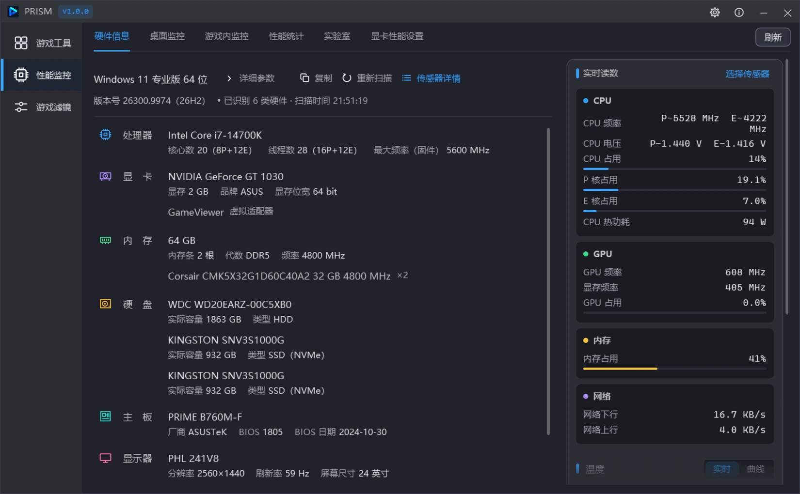
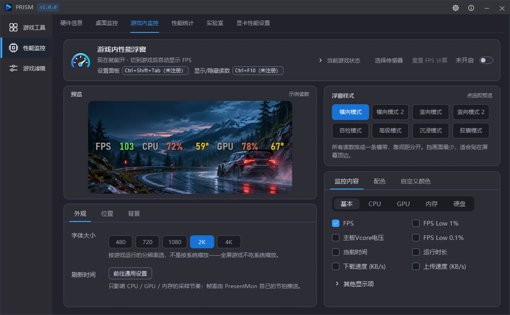
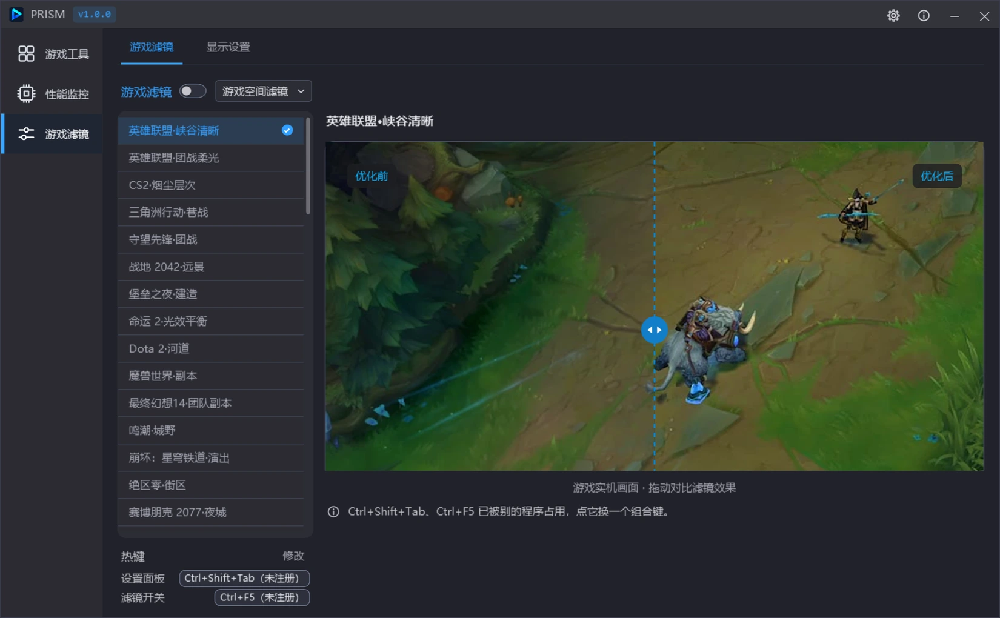

<p align="center">
  
</p>

<h1 align="center">PRISM</h1>

<p align="center">Game performance and hardware tuning toolkit for Windows. Monitor your hardware, overlay FPS in game, apply game filters and tune your PC from one place.</p>

<p align="center"><b>English</b> | <a href="README.zh-CN.md">简体中文</a></p>

> This repository only distributes the Windows installer and release notes for PRISM. The source code is not published here.

## Screenshots

**Hardware monitoring**



**In-game overlay settings**



**Game filter comparison**



## Download and install

1. Open [Releases](https://github.com/Moresyl/PRISM/releases/latest) and download `PRISM-Setup-<version>-x64.exe`.
2. A `.sha256` file with the same name sits next to every installer. Verify the download in PowerShell:

   ```powershell
   Get-FileHash .\PRISM-Setup-1.6.32-x64.exe -Algorithm SHA256
   ```

   The printed hash must match the value in the `.sha256` file. Do not install if it differs.
3. Run the installer. It installs to `C:\Program Files\PRISM` by default and can be removed from the Windows "Apps" page.
   The installer also installs the [PawnIO](https://pawnio.eu/) hardware access driver when the required version is missing; it is used to read low-level sensors, and Windows may ask for administrator rights.

## System requirements

- Windows 10 (version 2004 or later) or Windows 11, 64-bit
- No account is needed; everything except the update check works offline
- Some tuning features need administrator rights and ask for them when used
- The user interface is currently in Simplified Chinese

## Features

**Game tools**

- Game crash fixer: scans runtimes, DirectX and recent game crash records
- GPU performance check: driver, cache and in-game graphics settings
- AI frame interpolation: generates in-between frames by motion estimation, with FSR 1 upscaling and sharpening
- Memory cleaner with optional automatic cleaning
- C: drive cache cleaner: scans temporary files and graphics caches before anything is removed
- One-click PC tuning; stopping it restores the original settings

**Performance monitoring**

- Hardware overview: CPU, GPU, memory, storage, motherboard and display
- Live readings for frequency, voltage, load, power, temperature, network and disk space
- Desktop monitor and in-game FPS overlay (FPS captured with Intel PresentMon), with several overlay styles and hotkeys
- Performance history and a hardware lab for stress and stability checks

**Game filters**

- Per-game filter presets with a before / after comparison slider
- Display settings such as digital vibrance; the filter can be toggled with a hotkey

## Privacy

- Filter settings, hardware samples and performance reports are stored only on your machine.
- The client contacts `prism.9nn.cn` only when checking for updates, and you decide whether to download a new version.
- Exported reports are saved where you choose; nothing is uploaded automatically.
- The full terms are in [LICENSE.txt](LICENSE.txt). They are the same license agreement that the installer shows.

## Feedback

- Bugs and suggestions: [GitHub Issues](https://github.com/Moresyl/PRISM/issues)
- Website: https://prism.9nn.cn/
- Email: hi@9nn.cn
- Blog: https://blog.biekanle.com/

## Third-party components

PRISM uses LibreHardwareMonitor, Intel PresentMon, Vortice.Windows, the .NET runtime and other components. Their licenses are listed in [THIRD_PARTY_NOTICES.md](THIRD_PARTY_NOTICES.md).

## Copyright

© 2026 Mores. All rights reserved.
