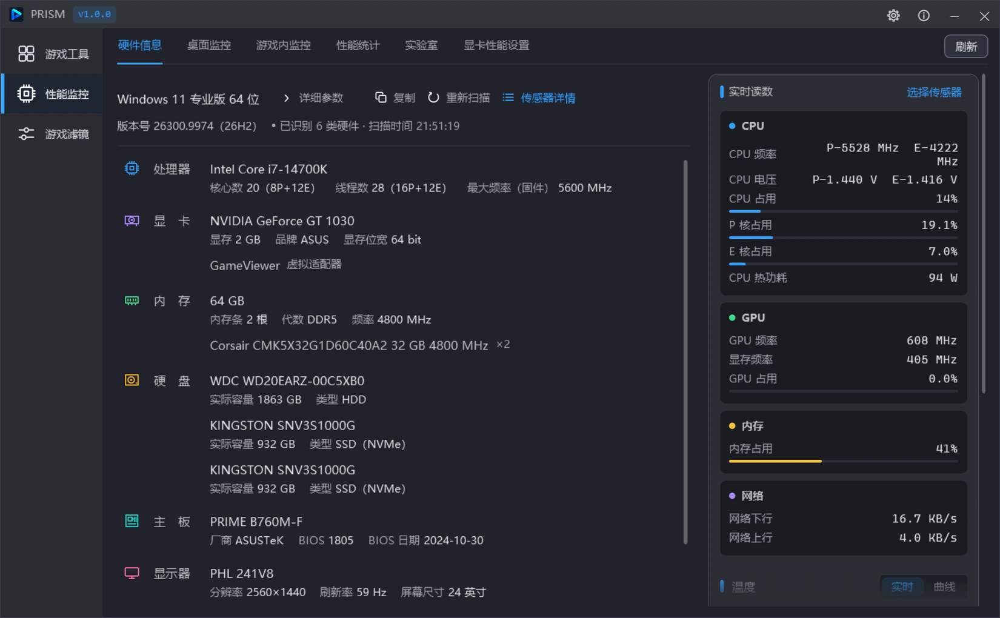
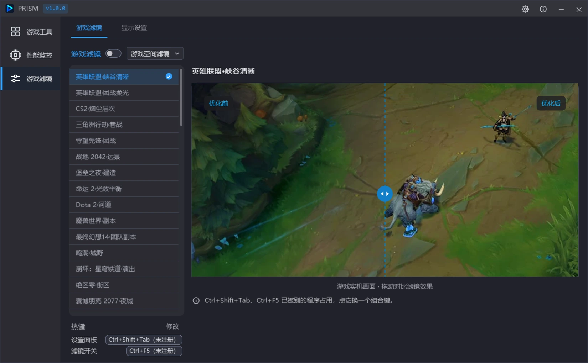

<p align="center">
  
</p>

<h1 align="center">PRISM</h1>

<p align="center">Windows 游戏性能与硬件调校工具箱。硬件监控、游戏内帧率浮窗、游戏滤镜和电脑优化，一个软件里完成。</p>

<p align="center"><a href="README.md">English</a> | <b>简体中文</b></p>

> 本仓库只发布 PRISM 的 Windows 安装包和版本说明，不包含源代码。

## 界面截图

**硬件信息与实时监控**



**游戏内性能浮窗设置**


**游戏滤镜效果对比**



## 下载与安装

1. 打开 [Releases](https://github.com/Moresyl/PRISM/releases/latest)，下载 `PRISM-Setup-<版本>-x64.exe`。
2. 每个安装包旁边都有同名的 `.sha256` 文件。下载后可以在 PowerShell 中校验：

   ```powershell
   Get-FileHash .\PRISM-Setup-1.6.32-x64.exe -Algorithm SHA256
   ```

   输出的哈希值应与 `.sha256` 文件中的值一致。不一致时请不要安装。
3. 运行安装包。默认安装到 `C:\Program Files\PRISM`，可以在 Windows「应用」页面卸载。
   缺少所需版本时，安装程序会一并安装 [PawnIO](https://pawnio.eu/) 硬件访问驱动，用于读取底层传感器，Windows 可能请求管理员权限。

## 系统要求

- Windows 10（2004 及以上）或 Windows 11，64 位
- 不需要注册账号，除检查更新外都可以离线使用
- 部分调校功能需要管理员权限，用到时才会申请
- 界面目前为简体中文

## 功能

**游戏工具**

- 游戏闪退修复：扫描运行库、DirectX 和近期游戏崩溃记录
- 显卡性能优化：检查显卡驱动、缓存和游戏图形设置
- AI 智能补帧：通过运动估计生成中间帧，支持 FSR 1 缩放与锐化
- 内存智能清理，可设定自动清理
- C 盘缓存清理：先扫描临时文件和图形缓存，确认后再清理
- 电脑深度优化：一键应用，停止优化时恢复原设置

**性能监控**

- 硬件信息：处理器、显卡、内存、硬盘、主板、显示器
- 实时读数：频率、电压、占用、功耗、温度、网络和磁盘空间
- 桌面监控与游戏内帧率浮窗（帧率由 Intel PresentMon 采集），多种浮窗样式，支持快捷键
- 性能统计，以及用于压力与稳定性检查的硬件实验室

**游戏滤镜**

- 按游戏提供滤镜方案，拖动滑块对比优化前后
- 数字振动等显示设置；滤镜可以用快捷键开关

## 隐私

- 滤镜设置、硬件采样和性能报告只保存在本机。
- 客户端只在检查更新时访问 `prism.9nn.cn` 获取版本信息，是否下载新版本由你决定。
- 导出报告时由你选择保存位置，不会自动上传。
- 完整条款见 [LICENSE.txt](LICENSE.txt)，内容与安装程序中显示的《PRISM 软件许可协议》一致。

## 反馈

- 问题与建议：[GitHub Issues](https://github.com/Moresyl/PRISM/issues)
- 官网：https://prism.9nn.cn/
- 邮箱：hi@9nn.cn
- 博客：https://blog.biekanle.com/

## 第三方组件

PRISM 使用 LibreHardwareMonitor、Intel PresentMon、Vortice.Windows、.NET 运行时等组件，各组件的许可证见 [THIRD_PARTY_NOTICES.md](THIRD_PARTY_NOTICES.md)。

## 版权

© 2026 Mores。保留所有权利。
